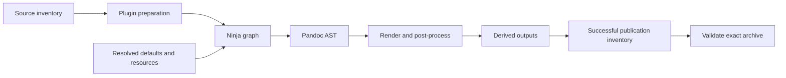

# Build and publication architecture

Dojo owns project discovery, Pandoc execution, the Ninja graph, output ownership, and publication
validation. Plugins own domain-specific preparation. Research catalogs, citation selection, Bible
data, and authoring UI belong in consumers such as Access; Dojo does not import or inspect those
packages.

## One supported build entry point

`dojo build -c /path/to/dojo.yaml` resolves all configuration paths against that file's directory.
Each invocation discovers sources, asks plugins to prepare their inputs, writes the graph only if it
changed, and runs Ninja incrementally. This also detects additions, removals, and changes to
preparation inputs. A successful full build finalizes the publication inventory. Specific-target
builds and `--generate-only` do not finalize a complete publication.

Raw Ninja invocation is useful for graph diagnostics, but does not discover new sources, run
preparation, or finalize ownership. Use `dojo build` for development, watchers, and CI. `--dry-run`
validates configuration and reports discovery without running preparation hooks, tools, or writing
build products.

## Directory responsibilities

| Location                  | Contents                                                                                                  | Lifetime         |
| ------------------------- | --------------------------------------------------------------------------------------------------------- | ---------------- |
| Source/config directories | Authoritative inputs                                                                                      | User-managed     |
| `_build/`                 | ASTs, depfiles, normalized defaults, intermediate render products, locks, caches, private ownership state | Disposable       |
| `_site/`                  | Final outputs, copied assets, extracted media, public provenance and inventory                            | Published        |
| `release.txz`             | Only inventory members, with normalized archive metadata                                                  | Release artifact |

Keeping `_build` separate from `_site` is intentional: private state must never be selected for
publication by filename heuristics. Hidden files explicitly declared as publication assets are
valid. Render intermediates never enter `_site`.

## Dependency model

Defaults are resolved recursively once per distinct stage configuration. The same resolver supplies
execution paths and Ninja dependencies: inherited defaults, metadata files, templates and partials,
filters, citation styles, bibliographies, includes, and reference documents. `${.}` refers to the
containing defaults file. Ordinary relative configuration paths refer to the project root.

The compile filter records source-relative images, bibliography/CSL metadata, and explicit metadata
dependencies in a depfile. Copied frontmatter assets and plugin assets are declared edges. Built-in
rules depend on their wrapper implementation, bundled resources, and resolved tool executables.
Render rules also track configured font files. Custom tools can declare additional `dependencies` on
the rule or output. Directory membership is refreshed on every supported build invocation.

Static assets are prerequisites for all renders. Plain HTML can link assets without embedding their
bytes, so unrelated static edits do not invalidate it. PDF, derived, and embedded HTML outputs
conservatively depend on the shared static stamp. `consumes_assets` explicitly overrides that
policy; set it to false only when a custom tool's declared inputs fully describe its resource
consumption. This deliberately favors correctness for arbitrary browser scripts over claiming a
complete static analysis of JavaScript requests.

Ninja tracks modification times for ordinary inputs. Plugins may use content fingerprints where
stronger identity is required. Replacing a source while preserving its timestamp is outside Ninja's
general contract; Access's research preparation caches hash their semantic inputs.

## Transactions and ownership

A POSIX file lock serializes graph generation, execution, and finalization for one build directory.
Nested graph regeneration inherits the lock. Packaging acquires the same lock. Dry runs acquire no
persistent lock or directory.

Managed tools write to a temporary directory using the intended output basename; a successful exit
replaces the final file. Failed tools preserve the previous output. Each render owns a separate
extracted-media directory. Replacement removes obsolete derivatives, and the previous inventory
invalidates a producer if one of its media files is missing or corrupt. These are per-output
transactions, not an atomic swap of the entire site. A failed build may have updated some outputs;
packaging rejects any mismatch against the last successful inventory.

Finalization records checksums and reconciles previously owned obsolete files. Independently
modified or unowned files are preserved and excluded from archives. The public inventory survives
deletion of `_build`; private producer paths are kept only in `_build/publication.json`. A one-time
migration recognizes outputs in an existing Ninja graph and the old reserved `.dojo-tmp-*`
intermediate names.

`dojo package` verifies the inventory, creates a sorted archive with normalized ownership, mode, and
timestamps, extracts it, validates those exact bytes, and only then replaces the archive and writes
its SHA-256 sidecar. Archive repeatability assumes identical publication bytes; PDF engines and
author-supplied timestamps may require their own reproducibility settings.

## Validation and browser compression

`dojo check-output` checks resources and duplicate IDs, including hidden HTML/CSS. `--links` adds
local navigation and fragment checks; recognized Reveal containers support Reveal hash routes.
`--offline` rejects external resource URLs but permits outbound navigation. Both flags can also be
passed to `dojo package`.

Embedded CSS/SVG/HTML resources are inspected recursively with a nesting limit. SVG fragments retain
their embedded document scope. Static validation does not execute arbitrary JavaScript, evaluate
conditional CSS selectors or fragment-only CSS effects, or infer dynamic network requests. The
browser integration tests exercise the actual compressed loader with HTTP(S) blocked.

Crunch publications carry a validation manifest, ordered transport chunks, CRCs, and size checks.
Validation decodes the real HTML before inspecting references. The vendored decoder's license,
version, checksum, update instructions, and 32 MiB history limit are documented in
`src/dojo/resources/README.md`.

## Modules and extension points

| Module                                         | Responsibility                                                    |
| ---------------------------------------------- | ----------------------------------------------------------------- |
| `config.py`, `schema.py`                       | Configuration contract, output DAG, schema export                 |
| `defaults.py`, `yaml_utils.py`, `resources.py` | Resource resolution and normalized execution defaults             |
| `core.py`, `stages/`, `emitter.py`             | Discovery, declarative contributions, graph generation            |
| `plugins.py`                                   | Public preparation context, contributions, trusted module loading |
| `wrap.py`, `rules.py`                          | Tool argv, URL context, atomic output and media replacement       |
| `artifacts.py`, `locking.py`, `io.py`          | Publication ownership, archive transaction, local locking/writes  |
| `validation.py`, `crunch.py`                   | Static validation and offline compressed HTML                     |

Tests combine unit contracts, real Pandoc/Ninja workflows, failure injection, archive round trips,
and Chromium execution. Subprocess coverage is enabled so CLI workflows count toward the unchanged
100% branch coverage gate.
