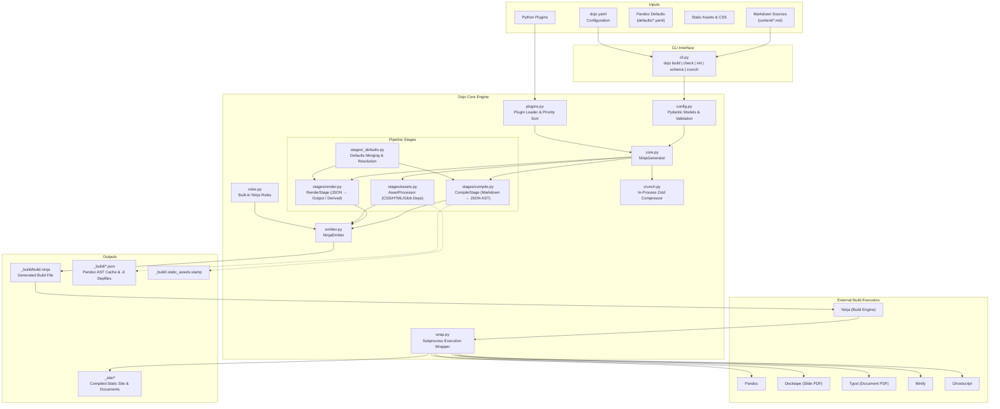

# Dojo Architecture Guide

> Ninja Build Generator for Static Site Generation and Document Processing

## Overview

Dojo bridges the gap between flexible markup conversion and high-performance, incremental build
engineering. It transforms Markdown and structured content into static websites, multi-format
documents, and presentation slide decks by compiling Markdown to an intermediate
[Pandoc](https://pandoc.org/) JSON AST, analyzing asset and dependency graphs, and emitting
optimized [Ninja](https://ninja-build.org/) build files.

By offloading dependency resolution, file-change detection, and process concurrency to Ninja, Dojo
achieves near-instantaneous incremental rebuilds even for complex pipelines involving PDF rendering,
image optimization, and offline compression.

______________________________________________________________________

## Architecture Diagram



______________________________________________________________________

## Module Directory and Responsibilities

The following table summarizes the roles and key APIs of each module in the Dojo codebase:

| Module                | Category       | Primary Purpose                                                                                            | Key Classes & Functions                                                                                                       |
| --------------------- | -------------- | ---------------------------------------------------------------------------------------------------------- | ----------------------------------------------------------------------------------------------------------------------------- |
| `cli.py`              | CLI            | Argument parsing, command dispatching, and console presentation                                            | `main()`, `entry_point()`, `cmd_build()`, `cmd_check()`, `cmd_init()`, `cmd_schema()`, `cmd_version()`, `cmd_crunch()`        |
| `config.py`           | Configuration  | Pydantic schema validation, tool path resolution, directory conflict checks                                | `Config`, `TypeConfig`, `OutputConfig`, `ToolPaths`, `PipelineStep`, `CustomRule`, `load_config()`                            |
| `constants.py`        | Constants      | Shared enumerations for Ninja rules and asset tracking keys                                                | `RuleName`, `ASSET_KEYS`                                                                                                      |
| `core.py`             | Orchestration  | High-level generator that drives stages, applies plugins, and writes `build.ninja`                         | `NinjaGenerator`                                                                                                              |
| `crunch.py`           | Compression    | Standalone and pipeline offline HTML compression using in-process Zstd and Web Worker decoder              | `crunch_file()`, `generate_payloads()`, `encode_base91()`, `main()`                                                           |
| `deps.py`             | Asset Scanning | Recursive scanning of CSS `url()` and HTML `src`/`href` links, glob pattern resolution                     | `scan_css_dependencies()`, `scan_html_dependencies()`, `resolve_glob_dependencies()`, `is_remote_url()`, `strip_url_params()` |
| `emitter.py`          | Emission       | Low-level generation of Ninja syntax (rules, build edges, variables, pools)                                | `NinjaEmitter`                                                                                                                |
| `exceptions.py`       | Exceptions     | Structured hierarchy of domain exceptions for configuration, security, and runtime errors                  | `DojoError`, `ConfigError`, `ConfigInvalidError`, `SecurityError`, `PluginLoadError`, `CrunchError`                           |
| `log_config.py`       | Logging        | Rich terminal formatting and single-line structured JSON logging for CI                                    | `setup_logging()`, `JsonFormatter`                                                                                            |
| `paths.py`            | Utilities      | Path sanitization (traversal prevention), shell quoting, Ninja escaping, file filtering                    | `sanitize_path()`, `shell_quote()`, `ninja_escape()`, `ninja_quote()`, `should_process_file()`                                |
| `plugins.py`          | Extensibility  | Dynamic loading, validation, and priority sorting of Python plugins                                        | `PluginInterface`, `load_plugin()`                                                                                            |
| `resources.py`        | Resources      | Resource discovery across project roots and XDG/Pandoc data directories                                    | `find_resource()`, `clear_resource_cache()`, `get_pandoc_data_dirs()`, `get_xdg_data_home()`                                  |
| `rules.py`            | Rules          | Factory for built-in Ninja rules configured with tool paths and wrapper flags                              | `get_builtin_rules()`                                                                                                         |
| `schema.py`           | Schema         | JSON Schema generation from Pydantic models for IDE autocomplete                                           | `generate_schema()`, `write_schema()`, `print_schema()`                                                                       |
| `stages/__init__.py`  | Pipeline       | Module exports for decomposed build pipeline stages                                                        | `CompileStage`, `RenderStage`, `AssetProcessor`                                                                               |
| `stages/_defaults.py` | Pipeline       | Shared default merging and Pandoc `-d` variable formatting across stages                                   | `resolve_stage_dependencies()`, `merge_defaults()`, `format_defaults_var()`                                                   |
| `stages/assets.py`    | Pipeline       | Dependency copying, deduplication, recursive asset queuing, static asset stamps                            | `AssetProcessor`                                                                                                              |
| `stages/compile.py`   | Pipeline       | Compiles Markdown to JSON AST via Pandoc with Lua dependency tracking                                      | `CompileStage`                                                                                                                |
| `stages/render.py`    | Pipeline       | Renders JSON AST to final formats, executes derived builds and post-process steps                          | `RenderStage`                                                                                                                 |
| `wrap.py`             | Subprocess     | Cross-platform command wrapper with directory creation, ephemeral HTTP serving, and AST override injection | `run_wrap()`, `PlaceholderContext`, `resolve_placeholders()`                                                                  |
| `yaml_utils.py`       | YAML Parsing   | Frontmatter parsing, `${.}` and env expansion, recursive YAML defaults scanning                            | `parse_frontmatter()`, `parse_frontmatter_type()`, `get_frontmatter_assets()`, `get_recursive_yaml_deps()`                    |

______________________________________________________________________

## The Build Pipeline Lifecycle

Dojo executes build generation in five coordinated stages:

```
[1. Compile Stage] ──> [2. Asset Processing] ──> [3. Render & Derive] ──> [4. Post-Process] ──> [5. Plugin Hooks & Ninja Emission]
```

### 1. Compile Stage (`stages/compile.py`)

- **Input:** Source Markdown files (`content/**/*.md`)
- **Output:** Pandoc JSON AST files (`_build/**/*.json`)
- **Depfile:** Makefile-formatted dependency list (`_build/**/*.json.d`)
- **Tool:** Pandoc (`-t json`) with `dependencies.lua`

The Compile Stage converts raw Markdown with YAML frontmatter into Pandoc's Abstract Syntax Tree
(AST) in JSON format. This intermediate representation decouple content parsing from formatting and
provides:

1. **AST Inspection**: Downstream stages can inspect document metadata without re-reading or re-parsing
   Markdown.
2. **Dynamic Depfiles**: Dojo's bundled Lua filter (`dependencies.lua`) inspects inline images and
   frontmatter `dependencies`, emitting a `.json.d` depfile. Ninja uses this depfile to trigger
   recompilations whenever linked local images or referenced files change on disk.
3. **One-to-Many Rendering**: A single compiled JSON AST file serves as the input to multiple render
   targets (e.g., HTML, PDF, presentation slides).

### 2. Asset Processing Stage (`stages/assets.py`)

- **Input:** Markdown frontmatter (`css`, `dependencies`), linked CSS stylesheets, HTML files, and
  `static_dirs`
- **Output:** Copied assets in `_site/` and a group stamp file `_build/.static_assets.stamp`
- **Tool:** `dojo wrap --copy`

Assets are discovered through multiple mechanisms:

- **Frontmatter references**: The `css` key and keys defined in `ASSET_KEYS` (`template`, `csl`,
  `bibliography`, `metadata-files`).
- **Glob patterns**: Paths matched by glob patterns in the `dependencies` frontmatter field.
- **Recursive CSS scanning**: Parses `url(...)` declarations to discover nested fonts, images, and
  sub-stylesheets.
- **Recursive HTML scanning**: Parses local `src="..."` and `href="..."` attributes.
- **Static asset directories**: Entire directories configured in `static_dirs` are copied to the
  output directory. To keep Ninja build files compact and dependency graphs clean, static directory
  outputs are aggregated into a single `.static_assets.stamp` dependency file.

### 3. Render and Derive Stage (`stages/render.py`)

- **Input:** `_build/**/*.json` AST files (or sibling build products for derived outputs)
- **Output:** Formatted documents (`.html`, `.pdf`, `.epub`, etc.) in `_site/`
- **Tool:** Pandoc (for primary rendering), Decktape / Typst / custom tools (for derived outputs)

The Render Stage transforms the intermediate JSON AST into target formats using Pandoc defaults
files, templates, and format-specific command arguments.

#### Derived Outputs

Outputs can be derived from other outputs rather than the JSON AST. For example, HTML slides
produced by Pandoc can be converted to PDF via Decktape:

```yaml
types:
  slide:
    outputs:
      - id: html
        extension: html
        defaults: defaults/slide.yaml
      - id: pdf
        extension: pdf
        source: html # Derived from the 'html' output above
        tool: decktape # Uses Decktape rule
        args: ["--size", "1920x1080"]
```

### 4. Post-Processing Pipeline

Outputs can define multi-step post-processing pipelines. Each step runs sequentially using
intermediate temporary files (`.dojo-tmp-<filename>.<step>.<ext>`) before writing the final product:

```yaml
outputs:
  - id: html
    extension: html
    defaults: defaults/page.yaml
    post_process:
      - tool: minify
      - tool: crunch
        args: ["-l", "22", "--window-log", "26"]
```

Built-in post-processing tools include:

- `minify`: HTML, CSS, and JS minification via `minify`.
- `crunch`: Self-extracting offline HTML compression with Zstandard and an embedded Web Worker.
- `ghostscript`: PDF compression and optimization via Ghostscript (`gs`).
- Any custom tool registered via `custom_rules` or plugins.

### 5. Cross-Format Sibling Links (`format_links`)

When `format_links: true` is enabled in `dojo.yaml`, Dojo automatically generates cross-format
navigation links for content types with multiple outputs (e.g., linking from an HTML article to its
PDF download):

1. `NinjaGenerator._generate_format_link_defaults()` calculates sibling formats for each output.
2. An intermediate defaults YAML file is generated in `_build/_dojo/format-links-<type>-<output>.yaml`.
3. The defaults file injects the bundled `format_links.lua` filter and sets `dojo-sibling-formats`
   metadata.
4. The Lua filter populates `format-links` metadata in the document AST, which custom Pandoc templates
   render using `$for(format-links)$ <a href="$it.href$">$it.label$</a> $endfor$`.

______________________________________________________________________

## Subprocess Execution Wrapper (`wrap.py`)

Rather than invoking external CLI binaries directly in Ninja rules, Dojo routes commands through
[`wrap.py`](../src/dojo/wrap.py). This wrapper provides several critical functions:

1. **Cross-Platform Compatibility**: Resolves paths consistently across Linux, macOS, and Windows.
2. **Directory Pre-Creation (`--ensure-dir`)**: Automatically creates target parent directories before
   tools execute, preventing crashes from tools that expect the output directory to exist.
3. **Failure Cleanup**: If a tool exits with a non-zero status code, `wrap.py` unlinks the target
   output file to ensure Ninja does not treat a corrupt or partial file as up-to-date.
4. **Environment Isolation (`--path-env`)**: Prepends configured tool directories to `$PATH`.
5. **Ephemeral HTTP Server (`--serve-dir`)**: Decktape requires an HTTP server to capture Reveal.js or
   HTML presentations. `wrap.py` spins up an ephemeral localhost HTTP server on an available port,
   serves the build output directory during Decktape's execution, passes the temporary `{url}` to
   Decktape, and shuts down the server upon completion.
6. **AST Metadata Override Injection**: For Pandoc render commands, `wrap.py` reads the JSON AST input
   and automatically injects CLI flags based on document frontmatter:
   - Sets `--slide-level=<val>` if `slide-level` is defined in document metadata.
   - Appends or strips `--toc` if `toc: true` or `toc: false` is defined.

### Command Template Placeholders

Ninja rules that use `dojo wrap` can use `{placeholder}` tokens that `wrap.py` expands at runtime:

| Placeholder     | Description                                                                            |
| --------------- | -------------------------------------------------------------------------------------- |
| `{in_abs}`      | Absolute path to the input file (`$in`).                                               |
| `{out_abs}`     | Absolute path to the output file (`$out`).                                             |
| `{in_abs_dir}`  | Absolute directory containing the input file.                                          |
| `{out_abs_dir}` | Absolute directory containing the output file.                                         |
| `{root_val}`    | Relative path from `{out_abs_dir}` back to project root or build root.                 |
| `{src_dir}`     | Absolute source directory path (`config.src_dir`).                                     |
| `{out_dir}`     | Absolute output directory path (`config.output_dir`).                                  |
| `{build_dir}`   | Absolute build directory path (`config.build_dir`).                                    |
| `{rel_src_dir}` | Relative path from `{build_dir}` to `{in_abs_dir}`.                                    |
| `{src_dir_val}` | Resolved source path combined with `{rel_src_dir}`.                                    |
| `{serve_dir}`   | Root directory served by the ephemeral HTTP server.                                    |
| `{url}`         | Localhost URL generated for Decktape slide capture (`http://127.0.0.1:<port>/<path>`). |

______________________________________________________________________

## Ninja Rule Variables

Dojo defines a standard convention for Ninja rule variables:

| Variable     | Scope          | Description                                                                 |
| ------------ | -------------- | --------------------------------------------------------------------------- |
| `$in`        | Ninja Built-in | Raw input file path(s).                                                     |
| `$out`       | Ninja Built-in | Raw output file path(s).                                                    |
| `$in_shell`  | Dojo Variable  | Shell-quoted input path (using `shlex.quote`) safe for shell commands.      |
| `$out_shell` | Dojo Variable  | Shell-quoted output path.                                                   |
| `$args`      | Dojo Variable  | Extra arguments specified on `OutputConfig` or `PipelineStep`.              |
| `$defaults`  | Dojo Variable  | Resolved space-separated list of Pandoc defaults flags (`-d ...`).          |
| `$dojo_stem` | Dojo Variable  | Base filename stem without suffix or extension (used for media extraction). |

______________________________________________________________________

## Resource Pools and Concurrency Control

Static site generation often involves CPU-intensive or memory-heavy tasks (such as running headless
Chromium via Decktape or processing large PDFs with Ghostscript). Running too many parallel
instances can saturate memory or crash builds.

Dojo leverages Ninja's native resource pooling. Pools are configured in `dojo.yaml`:

```yaml
pools:
  heavy: 2 # Limit heavy tasks to 2 parallel processes
  media: 4 # Limit image optimization to 4 parallel processes
rule_pools:
  decktape: heavy
  ghostscript: heavy
  optimize_png: media
```

Dojo emits `pool` definitions at the top of `build.ninja` and attaches each rule to its designated
pool.

______________________________________________________________________

## Configuration Reference

The following annotated `dojo.yaml` illustrates all available configuration options:

```yaml
# =============================================================================
# Directories & Defaults
# =============================================================================
src_dir: content # Source directory containing Markdown files (default: "content")
output_dir: _site # Destination directory for final site output (default: "_site")
build_dir: _build # Directory for intermediate AST and build files (default: "_build")
default_type: page # Content type assigned to files lacking frontmatter 'type'
# =============================================================================
# Concurrency Pools
# =============================================================================
pools:
  heavy: 2 # Maximum concurrent jobs for this pool
rule_pools:
  decktape: heavy # Map rule name to pool name
# =============================================================================
# Tool Path Overrides (Optional)
# =============================================================================
tools:
  pandoc: pandoc # Executable path or binary name
  minify: minify
  ghostscript: gs
  decktape: decktape
  typst: typst
# =============================================================================
# Filtering & Inclusion
# =============================================================================
include: [] # Glob patterns to include (empty = include all)
exclude: # Glob patterns to exclude
  - "drafts/*"
  - "templates/*"
# =============================================================================
# Assets & Fonts
# =============================================================================
static_dirs: # Directories copied verbatim to output_dir
  - assets
font_paths: # Font directories for Typst rendering
  - fonts
# =============================================================================
# Pandoc Options
# =============================================================================
pandoc_data_dir: null # Custom Pandoc data directory
root_ref_dir: "." # Directory to calculate root variable relative to
add_resource_path: true # Automatically add input directory to Pandoc resource path
format_links: true # Auto-generate cross-format sibling navigation links
log_file: "" # Path to log file for redirecting noisy subprocess output
# =============================================================================
# Content Type Definitions
# =============================================================================
types:
  page:
    outputs:
      - id: html
        extension: html
        defaults: defaults/page.yaml
        post_process:
          - tool: minify
  report:
    outputs:
      - id: html
        extension: html
        defaults: defaults/report.yaml
      - id: pdf
        extension: pdf
        defaults: defaults/report-pdf.yaml
  presentation:
    outputs:
      - id: html
        extension: html
        defaults: defaults/slides.yaml
      - id: pdf
        extension: pdf
        source: html
        tool: decktape
        args: ["--size", "1920x1080"]
        post_process:
          - tool: ghostscript
            args: ["-dPDFSETTINGS=/screen"]
# =============================================================================
# Plugins & Custom Rules
# =============================================================================
plugins:
  - plugins/custom_plugin.py
custom_rules:
  - name: compress_data
    command: gzip -9 -c $in > $out
    description: 🗜️ GZIP $out
```

Run `dojo schema` to export the complete JSON Schema definition for VSCode, Neovim, or other IDEs.

______________________________________________________________________

## Directory Layout & Artifacts

A typical Dojo project directory structure:

```
my-project/
├── dojo.yaml                     # Primary project configuration
├── content/                      # Source Markdown documents
│   ├── index.md                  # Home page (frontmatter: type: page)
│   ├── blog/
│   │   └── post-1.md
│   └── slides/
│       └── talk.md               # Slides (frontmatter: type: presentation)
├── defaults/                     # Pandoc YAML defaults files
│   ├── page.yaml
│   └── slides.yaml
├── assets/                       # Static files (images, stylesheets)
│   └── style.css
├── _build/                       # Build artifacts (git-ignored)
│   ├── build.ninja               # Generated Ninja build file
│   ├── .static_assets.stamp      # Static asset synchronization stamp
│   ├── _dojo/                    # Internal defaults for format links
│   │   └── format-links-*.yaml
│   └── content/
│       ├── index.json            # Pandoc JSON AST cache
│       └── index.json.d          # Discovered dependency depfile
└── _site/                        # Final generated output (git-ignored)
    ├── index.html
    ├── blog/
    │   └── post-1.html
    ├── slides/
    │   ├── talk.html
    │   └── talk.pdf
    └── assets/
        └── style.css
```
